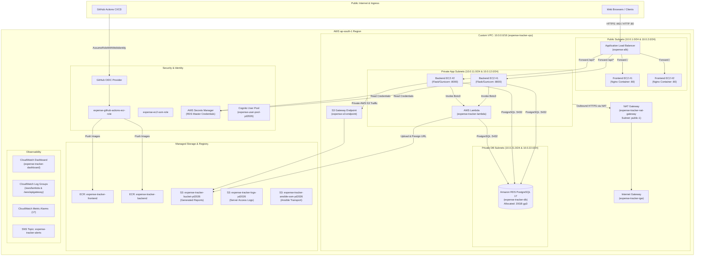

# Architecture Overview & AWS Service Relationships

**Project**: Cloud Expense Tracker AWS  
**Evaluation Date**: 2026-10-17  
**Region**: `ap-south-1`  

---

## 1. System Topology & Tier Architecture

The application implements a multi-tier, high-availability architecture deployed across two Availability Zones (`ap-south-1a` and `ap-south-1b`) within a dedicated Virtual Private Cloud (VPC).

---

## 2. Core Service Relationships & Data Paths

### A. Traffic Ingress & Load Balancing
- **Application Load Balancer (`expense-alb`)**:
  - Attached to public subnets across AZ `ap-south-1a` and `ap-south-1b`.
  - HTTP Listener (port 80) redirects to HTTPS (port 443).
  - Target Group `expense-target-group-frontend` (Port 80) targets instances `i-0b0294fc87c9ac832` and `i-0d180a9a22ab66f1a`.
  - Target Group `expense-target-group-backend` (Port 8000) targets instances `i-0a973fbbf1c0e01e3` and `i-048b2374625ee144e`.

### B. Application & Serverless Reporting
- **Backend Instances**:
  - Run Gunicorn + Flask serving API endpoints (`/api/expenses`, `/api/summary`, `/api/reports`).
  - Retrieve PostgreSQL database credentials dynamically from AWS Secrets Manager using IAM instance profile `expense-ec2-ssm-profile`.
- **Lambda Reporting Service (`expense-tracker-lambda`)**:
  - Python 3.12 runtime configured in VPC private subnets.
  - Queries RDS PostgreSQL directly, formats JSON summary reports, stores them in `expense-tracker-bucket-yd2026`, and returns presigned S3 URLs to the client.
- **Standby API Gateway HTTP API (`expense-tracker-api`)**:
  - ID: `d3dpf59d6g`.
  - Standby route `POST /reports` integrated with Lambda with Cognito JWT authorizer (`ap-south-1_uaZaEifVt`).

### C. Networking & Egress
- **NAT Gateway (`nat-00b6ef51e976e5998`)**:
  - Located in public subnet `subnet-00c7e3570173ad9ac` with Elastic IP allocation `eipalloc-032da56bffc50c262`.
  - Routes internet traffic for private application subnets (package updates, container pulls if needed).
- **S3 Gateway Endpoint (`vpce-07109946b5c3f8627`)**:
  - Associated with private route table `rtb-0d5d13fdd17ceef60`.
  - Direct, zero-cost routing between private EC2/Lambda and S3 without going through NAT Gateway.

### D. Observability & Alerting
- CloudWatch alarms monitor EC2 CPU/status, ALB response times and 5xx errors, RDS connections/storage/memory, Lambda errors/duration, and NAT Gateway packet drops.
- Alarms dispatch notifications to Amazon SNS topic `expense-tracker-alerts`.
