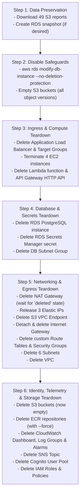

# Teardown Readiness Assessment & Risk Analysis (No Teardown Performed)

**Project**: Cloud Expense Tracker AWS  
**Evaluation Date**: 2026-10-17  
**Status**: **Evaluation Only — Teardown is on strict HOLD until explicitly approved.**  

---

## 1. Identified Teardown Blockers & Critical Risks

The following technical dependencies and safeguards currently prevent an automated or abrupt teardown:

### Blocker 1: RDS Instance Deletion Protection is Enabled
- **Resource**: `expense-tracker-db` (`aws_db_instance.expense_db_instance`)
- **Status**: Live property `DeletionProtection: true`.
- **Failure Mode**: Any attempt to issue `terraform destroy` or `aws rds delete-db-instance` without first modifying this flag will throw an `InvalidDBInstanceStateFault` error:
  ```
  Cannot delete the database instance because deletion protection is enabled.
  ```
- **Required Remediation (Future Teardown)**: Must explicitly modify the DB instance to disable deletion protection (`--no-deletion-protection`) prior to deletion.

### Blocker 2: S3 Buckets Contain Objects and Versions
- **Resources**:
  - `expense-tracker-bucket-yd2026` (Contains 49 reports, versioning enabled)
  - `expense-tracker-logs-yd2026` (Contains hundreds of access logs)
- **Status**: Neither bucket has `force_destroy = true` in Terraform configuration.
- **Failure Mode**: The AWS S3 API prohibits deletion of non-empty buckets (`BucketNotEmpty` error). In versioned buckets, all delete markers and historical object versions must be purged before the bucket itself can be deleted.
- **Required Remediation (Future Teardown)**: Objects must be downloaded/archived, and all versions must be emptied before bucket removal.

### Blocker 3: Local Terraform State is Missing
- **Status**: `terraform.tfstate` is absent locally.
- **Failure Mode**: Running `terraform destroy` locally executes against an empty state, resulting in `No changes. No objects need to be destroyed.` No cloud resources are removed, and billable services continue running silently.
- **Required Remediation (Future Teardown)**: Either (A) import live resources into Terraform state using `terraform import`, or (B) execute an orderly, dependency-aware teardown script using the AWS CLI.

### Blocker 4: Cross-Service Networking & Resource Locks
- **Dependencies**:
  - EC2 instances and Lambda functions are attached to ENIs (Elastic Network Interfaces) in VPC subnets.
  - Subnets cannot be deleted while ENIs, NAT Gateways, or ALBs are attached.
  - Security Groups cannot be deleted while referenced by other security groups or active network interfaces.
  - Internet Gateway cannot be detached while public subnets contain active routes.

---

## 2. Recommended Teardown Sequencing Plan (For Future Separately Approved Execution)

When teardown is formally authorized, execution should strictly follow this reverse-dependency order:



---

## 3. Post-Teardown Verification Checklist (Future Reference)

After any future teardown is executed, verify zero leftover resources by running:
- [ ] `aws ec2 describe-instances --filters "Name=instance-state-name,Values=running,pending"` (Verify 0 running EC2s)
- [ ] `aws ec2 describe-nat-gateways --filter "Name=state,Values=available,pending"` (Verify 0 NAT Gateways)
- [ ] `aws ec2 describe-addresses` (Verify 0 allocated Elastic IPs)
- [ ] `aws elbv2 describe-load-balancers` (Verify 0 ALBs)
- [ ] `aws rds describe-db-instances` (Verify 0 DB instances)
- [ ] `aws s3api list-buckets` (Verify project buckets removed)
- [ ] `aws cloudwatch describe-alarms` (Verify alarms removed, restoring free tier quota)
