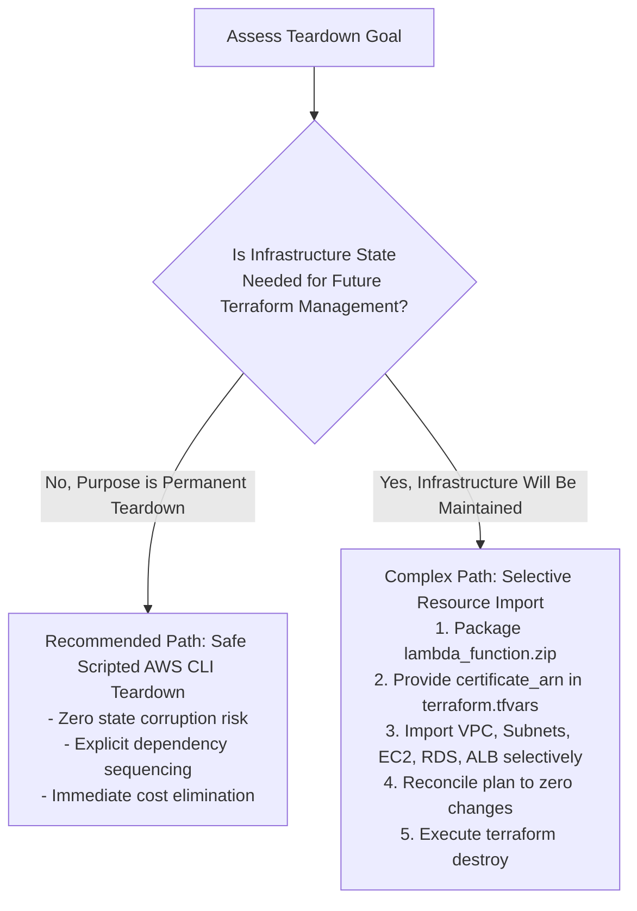

# Terraform State Situation & Recovery Assessment

**Project**: AWS Cloud Expense Tracker  
**Evaluation Date**: 2026-10-17  
**Terraform Version**: `v1.16.5`  
**Current Workspace**: `default`  

---

## 1. Backend & Workspace Configuration Audit

### A. Backend Definition
The Terraform configuration was examined across all files in `terraform/`:
- In `terraform/vpc.tf` (lines 1–8):
  ```hcl
  terraform {
    required_providers {
      aws = {
        source  = "hashicorp/aws"
        version = "~> 6.0"
      }
    }
  }
  ```
- **Finding**: There is **no backend configuration block** (e.g., `backend "s3"` or `backend "remote"`).
- **Default Behavior**: Terraform defaults to the `local` backend, storing state in a local file named `terraform.tfstate` in the execution directory (`terraform/`).

### B. Workspace Status
- Execution of `terraform -chdir=terraform workspace list` confirmed:
  ```
  * default
  ```
- **Finding**: Only the `default` workspace exists. No custom or alternative workspaces (such as `prod`, `dev`, or `staging`) are defined locally or recorded in `.terraform/environment`.

### C. State Search Across Filesystem & Git History
1. **Local Filesystem**: A full filesystem search (`find ~ -name "*tfstate*"`) located only two references, both of which were zero-byte lock artifacts from an unapplied dry-run plan created during earlier diagnosis. No non-empty `.tfstate` or `.tfstate.backup` file exists on the machine.
2. **Git Tree & History**:
   - `git status --ignored` revealed that `terraform/.terraform/` is ignored by Git.
   - `git log -p` and commit history inspection confirmed that `.gitignore` was configured to exclude `*.tfstate*` and `terraform.tfstate`. No state files were ever checked into source control (which aligns with security best practices, as state files contain plaintext database credentials and Secrets Manager ARNs).
3. **Remote S3 Buckets**:
   - An inspection of all S3 buckets in account `205639******` (`expense-tracker-ansible-ssm-yd2026`, `expense-tracker-bucket-yd2026`, `expense-tracker-logs-yd2026`) confirmed that none of them contain a Terraform state file (`*.tfstate`).

---

## 2. Why a Future `terraform destroy` Fails or Harms the Environment

If a user or automated tool attempts to run `terraform destroy` in the current working directory, the following failure and risk patterns emerge:

### Risk 1: The "Silent No-Op" Failure
- **Mechanism**: Terraform reads state before executing plans. Because no `terraform.tfstate` exists, Terraform evaluates state as containing 0 resources.
- **Result**:
  ```
  No changes. No objects need to be destroyed.
  ```
- **Consequence**: The operator assumes the environment is destroyed, while 114 live AWS resources (including NAT Gateway, ALB, EC2, and RDS) continue running in AWS, accumulating ongoing hourly and monthly charges silently.

### Risk 2: Blind State Recreation via Apply
- **Mechanism**: If an operator attempts to run `terraform apply` hoping to "sync" state before destroying, Terraform attempts to provision all 115 declared resources from scratch.
- **Result**:
  - AWS rejects duplicate S3 bucket creation (`BucketAlreadyExists`).
  - AWS rejects VPC CIDR or subnet overlaps.
  - AWS rejects duplicate IAM role names (`EntityAlreadyExists`).
  - RDS rejects duplicate DB instance identifier (`DBInstanceAlreadyExistsFault`).
- **Consequence**: The deployment crashes midway, leaving partial lock files or orphaned state.

### Risk 3: Risk of Blind Import (`terraform import`)
- Attempting to run `terraform import` for all 115 resources without a meticulous mapping of every subnet ID, security group rule, route table association, and IAM policy is highly error-prone:
  1. **Provider Drift**: Terraform AWS provider `v6.0` generates default attribute updates for RDS (e.g., parameter groups, maintenance windows, minor version upgrades) and ALB listeners that may force resource replacement during a plan.
  2. **Lambda Zip Packaging**: In `lambda.tf`, the Lambda function declares `filename = "lambda_function.zip"` and `source_code_hash = filebase64sha256("lambda_function.zip")`. Because `lambda_function.zip` does not exist in the working directory (only `lambda_function.py` is present), Terraform import and planning fail immediately with file open errors.
  3. **Variable Prompt Blockers**: Variables without defaults (specifically `certificate_arn`) block headless execution unless explicitly injected.

---

## 3. State Recovery Decision Tree



---

## 4. Assessment Conclusion

Because the user's objective is to evaluate the infrastructure for **teardown and cost remediation** (after hitting Free Tier alarm limits), **attempting a reverse-engineered 115-resource Terraform state import is unnecessary, fragile, and high-risk**. 

The safest, most reliable, and auditable approach for future teardown is an **orderly, dependency-aware AWS CLI script execution** that explicitly honors resource dependencies, validates data backups, and confirms zero residual billable assets.
